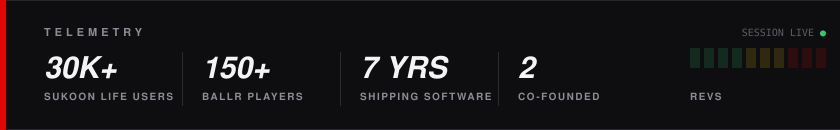

  

  

### DRIVER

Senior AI Engineer in the UK. Day job: multi-agent systems and LLM evaluation for regulated industries. Night job: building cool tech until I get bored.

### GARAGE

| | | |
| --- | --- | --- |
| **Sukoon Life** | Islamic guidance app, answers grounded in verified sources with RAG. Co-founder and CTO. | **30k+ users** · iOS + Android |
| **Ballr** | Fixtures, team sheets and pay-first Stripe checkout for casual football groups. Co-founder. | **150+ players** · piloting in Glasgow |

  

### SETUP

### PIT WALL

[LinkedIn](https://linkedin.com/in/ibraheem-latif) · ibraheem_latif@hotmail.com

Open to senior AI engineering and forward-deployed roles · remote UK or Gulf

